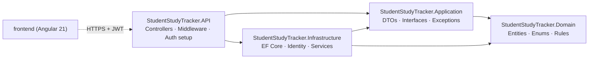
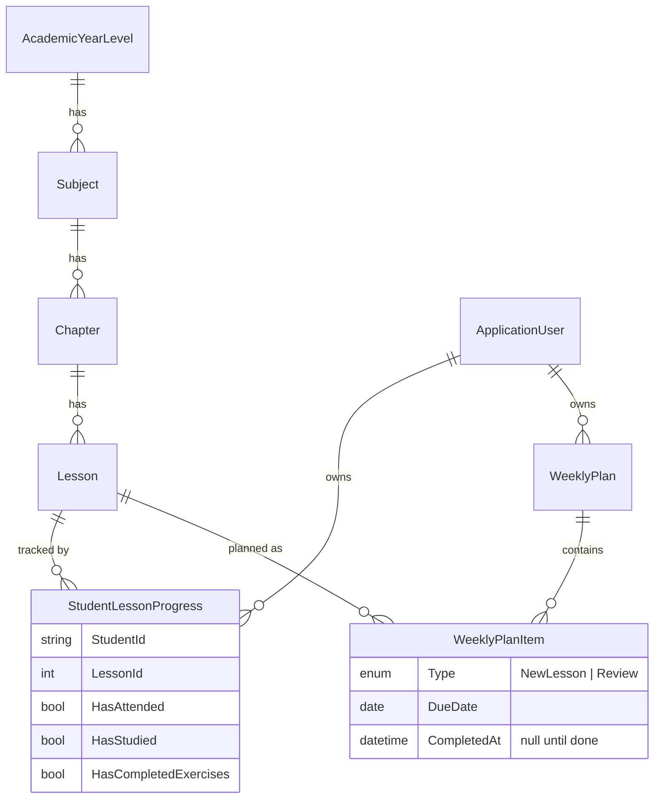

<div align="center">

# 📚 Student Study Tracker

**A full-stack study companion for Egyptian *Thanaweya Amma* students — track every lesson, plan the week, and never miss a review.**


[Features](#-features) · [Architecture](#-architecture) · [Data model](#-data-model) · [API](#-api-reference) · [Getting started](#-getting-started) · [Security](#-security) · [النسخة العربية](#-نبذة-بالعربي)

</div>

---

## ✨ Overview

Student Study Tracker helps high-school students stay on top of a large curriculum. Every lesson has **three independent tasks** — *attendance*, *studying* and *exercises* — and the app derives the lesson's status from them. Students plan their week (new lessons and **spaced reviews**), see a live dashboard, and an admin manages the shared curriculum.

It is built as a **portfolio-grade** project: a clean layered backend, a modern responsive Angular client, bilingual UI (Arabic RTL / English LTR), and security decisions that are explained rather than hand-waved.

<!-- Add screenshots after you run the app: docs/screenshots/dashboard.png etc. -->
<!--  -->

## 🚀 Features

### For students
- **Account & sign-in** — public registration (always creates a `Student`), JWT login, change password.
- **Curriculum browser** — year level → subject → chapter → lessons, showing only *published* content.
- **Per-lesson tracking** — tick *Attended / Studied / Exercises*; status is **computed** (`NotStarted` · `InProgress` · `Completed`), never stored.
- **Weekly plan** — Saturday-to-Friday weeks, add *new lessons* or *reviews*, edit, complete, delete; the same lesson can appear as both a new lesson and a review.
- **Dashboard** — overall progress ring, progress per subject, lessons in progress, **overdue** tasks, **reviews due**, and this week's completion.
- **Fully separate data** — a student can only ever see and change their own progress.

### For the admin
- Manage **year levels, subjects, chapters and lessons** (create / edit / reorder).
- **Publish / hide** any level with one switch. Content is archived, never deleted, so students' progress is preserved. Hiding a parent hides everything underneath it.

### Platform
- 🌍 **Arabic (RTL) + English (LTR)**, switchable at runtime, localized numbers and dates.
- 📱 **Mobile-first** responsive UI (bottom navigation on phones, sidebar on desktop).
- 🌗 Light / dark / system theme.
- ♿ Keyboard-friendly controls, ARIA labels, reduced-motion support.

## 🏗 Architecture

A **simplified Clean Architecture** with four projects. Dependencies only point inward — `Domain` knows nothing about anything else.



| Project | Responsibility |
|---|---|
| **Domain** | Entities, enums, business rules (e.g. `StudentLessonProgress.Status`). No dependencies. |
| **Application** | Request/response DTOs with validation, service interfaces, custom exceptions, week/clock helpers. |
| **Infrastructure** | `AppDbContext`, entity configurations, migrations, Identity, JWT, and the service implementations. |
| **API** | Thin controllers, exception-handling middleware, JWT/CORS/rate-limiting setup. |

> Deliberately **no Repository / Unit-of-Work wrapper** over EF Core — `DbContext` already is both. Layers exist only where they have a clear responsibility.

```
StudentStudyTracker/
├── StudentStudyTracker.Domain/          # Entities, Enums, Constants
├── StudentStudyTracker.Application/     # DTOs, Interfaces, Exceptions, Common
├── StudentStudyTracker.Infrastructure/  # Persistence, Configurations, Identity, Services, Migrations
├── StudentStudyTracker.API/             # Controllers (+ Admin/), Middleware, Program.cs
└── frontend/                            # Angular client
```

## 🗄 Data model



**Integrity is enforced by the database, not just the code:**

| Constraint | Purpose |
|---|---|
| Unique `(StudentId, LessonId)` on progress | One progress row per student per lesson |
| Unique `(StudentId, WeekStartDate)` on plans | One plan per student per week |
| Unique `(WeeklyPlanId, LessonId, Type)` on items | A lesson can't be added twice with the same type |
| `Restrict` delete on curriculum & progress | Curriculum can't be deleted out from under students' progress |
| `Cascade` only `WeeklyPlan → WeeklyPlanItem` | Removing a plan removes only its own items |

## 🧠 Key design decisions

| Decision | Why |
|---|---|
| **Lesson status is computed**, no `IsCompleted` column | A stored flag could contradict the three task flags. One source of truth. |
| **Archive via `IsPublished`**, no delete endpoints | Preserves student progress; hiding cascades through the 4 levels (`WherePublished()` is written once and reused). |
| **`StudentId` always comes from the JWT** | Clients can never write another student's data — the request body has no `studentId`. |
| **Review completion is independent** of the original lesson | A plan item's `CompletedAt` never touches lesson progress. |
| **Roles are set server-side** | Registration is hard-wired to `Student`; the body can't carry a role. |
| **Cairo time & Saturday weeks** | `AppClock` / `WeekCalendar` match how Egyptian students think about "today" and "this week". |
| **Typed exceptions → HTTP codes** in one middleware | `NotFound→404`, `Conflict→409`, `BadRequest→400`, `Unauthorized→401`, everything else → generic `500` (no stack traces leaked). |

## 🔐 Security

- ASP.NET Core **Identity** password hashing; password policy enforced on the server.
- **JWT** bearer auth (issuer, audience, lifetime and signing key validated); secrets live in **User Secrets / environment variables**, never in the repo.
- **Account lockout** after repeated failed logins, with a single generic error to avoid user enumeration.
- **Rate limiting** (per IP) on the auth endpoints.
- **Role-based authorization** (`Student` / `Admin`); ownership checks return `404` for other users' resources.
- **CORS** restricted to configured origins.
- The first **Admin is seeded from configuration** (no hard-coded password) and skipped if config is missing.

> Known trade-off: JWTs stay valid until they expire (60 min) even after a password change. Refresh tokens would address this and are on the roadmap.

## 📡 API reference

All routes are under `/api`. 🔓 = anonymous · 🎓 = Student · 🛡 = Admin · 🔑 = any signed-in user.

| Area | Method & route | Access |
|---|---|---|
| **Auth** | `POST /auth/register` · `POST /auth/login` | 🔓 |
| | `GET /auth/me` · `POST /auth/change-password` | 🔑 |
| **Curriculum** (published only) | `GET /year-levels` | 🔑 |
| | `GET /year-levels/{id}/subjects` | 🔑 |
| | `GET /subjects/{id}/chapters` | 🔑 |
| | `GET /chapters/{id}/lessons` | 🔑 |
| **Curriculum admin** | `GET·POST /admin/year-levels` · `PUT /admin/year-levels/{id}` | 🛡 |
| | `GET /admin/year-levels/{id}/subjects` · `POST /admin/subjects` · `PUT /admin/subjects/{id}` | 🛡 |
| | `GET /admin/subjects/{id}/chapters` · `POST /admin/chapters` · `PUT /admin/chapters/{id}` | 🛡 |
| | `GET /admin/chapters/{id}/lessons` · `POST /admin/lessons` · `PUT /admin/lessons/{id}` | 🛡 |
| **Progress** | `GET /progress/lessons/{id}` · `PUT /progress/lessons/{id}` | 🎓 |
| | `GET /progress/chapters/{id}` | 🎓 |
| **Weekly plan** | `GET /weekly-plans?date=yyyy-MM-dd` | 🎓 |
| | `POST /weekly-plans/items` · `PUT /weekly-plans/items/{id}` · `DELETE /weekly-plans/items/{id}` | 🎓 |
| | `POST /weekly-plans/items/{id}/complete` · `DELETE /weekly-plans/items/{id}/complete` | 🎓 |
| **Dashboard** | `GET /dashboard?yearLevelId=` | 🎓 |

Errors are returned as `{ "message": "..." }` with the proper status code.

## 🧰 Tech stack

| Layer | Technology |
|---|---|
| Backend | C#, ASP.NET Core Web API (.NET 10), Entity Framework Core, SQL Server, ASP.NET Core Identity, JWT |
| Frontend | Angular 21 (standalone components, signals, new control flow), TypeScript, RxJS, custom i18n, plain CSS design system |
| Tooling | Visual Studio, Git/GitHub, `.http` files for API testing |

## ⚡ Getting started

### Prerequisites
- [.NET 10 SDK](https://dotnet.microsoft.com/download)
- SQL Server (LocalDB / Express / full)
- [Node.js](https://nodejs.org) 20.19+ / 22.12+ and npm

### 1 · Backend

```bash
git clone https://github.com/mohamed-mostafa-ragab/StudentStudyTracker.git
cd StudentStudyTracker
```

Set the secrets for the API project (nothing sensitive is committed):

```bash
cd StudentStudyTracker.API
dotnet user-secrets init
dotnet user-secrets set "Jwt:Key" "<a random string of 32+ characters>"
dotnet user-secrets set "AdminSeed:Email" "admin@example.com"
dotnet user-secrets set "AdminSeed:Password" "<a strong password>"
dotnet user-secrets set "AdminSeed:FullName" "Administrator"
```

Check `ConnectionStrings:DefaultConnection` and `Cors:AllowedOrigins` in `appsettings.json`, then create the database and run:

```bash
dotnet tool install --global dotnet-ef        # once
dotnet ef database update --project ../StudentStudyTracker.Infrastructure --startup-project .
dotnet run --launch-profile https
```

(In Visual Studio: *Package Manager Console* → Default project `Infrastructure`, Startup project `API` → `Update-Database`.)

> If the browser rejects the HTTPS certificate: `dotnet dev-certs https --trust`.

| Setting | Where | Notes |
|---|---|---|
| `ConnectionStrings:DefaultConnection` | `appsettings.json` | Windows auth by default |
| `Jwt:Issuer` / `Audience` / `ExpiryMinutes` | `appsettings.json` | |
| `Jwt:Key` | **User Secrets / env var** | 32+ chars — the app refuses to start without it |
| `AdminSeed:*` | **User Secrets / env vars** (`AdminSeed__Email`…) | Admin is created on first start only |
| `Cors:AllowedOrigins` | `appsettings.json` | Add your frontend origin(s) |

### 2 · Frontend

```bash
cd frontend
npm install
```

Set the API address in `src/environments/environment.development.ts` (default `https://localhost:7177`), then:

```bash
npm start            # http://localhost:4200
```

Sign in with the seeded admin account to build the curriculum, then register a student account to use the tracker.

## 🧪 Testing the API

A scripted scenario (`tests.local.http`, git-ignored because it holds credentials) exercises permissions, the curriculum tree, progress, the weekly plan, the dashboard, lockout, password change and rate limiting. The key assertions:

- a student can't reach `/api/admin/*` (**403**) and an admin can't use student endpoints (**403**);
- registering with `"role": "Admin"` still yields a `Student`;
- a `studentId` sent in a request body is ignored;
- one student can't read or change another student's plan items (**404**);
- hiding a subject hides its chapters and lessons from students.

## 🗺 Roadmap

- [ ] Refresh tokens & token revocation
- [ ] Automated integration tests (`WebApplicationFactory`) and CI
- [ ] Automatic spaced-repetition scheduling for reviews
- [ ] Notifications / reminders, and PWA offline support
- [ ] Teacher/parent view and more year levels

## 👤 Author

**Mohamed Mostafa** — [@mohamed-mostafa-ragab](https://github.com/mohamed-mostafa-ragab)

## 📄 License

Released under the MIT License — add a `LICENSE` file to the repository.

---

## 🇪🇬 نبذة بالعربي

**Student Study Tracker** تطبيق ويب لمتابعة مذاكرة طلاب الثانوية العامة. كل درس له ثلاث مهام مستقلة: **حضور، مذاكرة، تدريبات**، وحالة الدرس (*لم يبدأ / قيد المذاكرة / مكتمل*) **بتتحسب** منها ولا بتتخزن، فمفيش تعارض في البيانات.

**المميزات**
- الطالب: تسجيل وتسجيل دخول، تصفح المنهج، متابعة تقدمه درس بدرس، **خطة أسبوعية** (دروس جديدة ومراجعات) من السبت للجمعة، ولوحة تحكم فيها نسبة الإنجاز والمتأخر والمراجعات المستحقة.
- الأدمن: إدارة السنوات والمواد والفصول والدروس، **ونشر/إخفاء** أي عنصر من غير حذف علشان تقدم الطلاب يفضل محفوظ.
- واجهة **عربي (RTL) وإنجليزي (LTR)** بتتبدل لحظيًا، ومتجاوبة مع الموبايل، ووضع فاتح وداكن.

**المعمارية:** Clean Architecture مبسطة من 4 مشروعات (Domain / Application / Infrastructure / API) وواجهة Angular. الأمان: Identity + JWT، حماية من التخمين (Lockout و Rate Limiting)، وصلاحيات بالأدوار، و`StudentId` بيتاخد دايمًا من التوكن مش من الطلب.

**التشغيل السريع:** اتبع قسم [Getting started](#-getting-started) أعلاه: اضبط الـ User Secrets، شغّل `Update-Database`، شغّل الـ API، وبعدها `npm install` و`npm start` في فولدر `frontend`.
